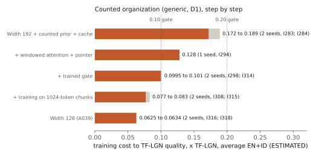

# CIR

CIR is a DotrixAI research program on how little training compute is needed to reach a given AI capability, compared with strong, optimized Transformer systems.

**Status: Primary lane paused (since 2026-10-15)** · Snapshot: 2026-10-16 13:00 UTC · Website: [dotrixai.com/cir](https://dotrixai.com/cir)

> This repository documents research, including results that did not hold up. Results are provisional unless marked REPRODUCED or VALIDATED, and many earlier claims have been narrowed or withdrawn as stronger baselines arrived. It contains research documentation only, not the CIR implementation.

## October 2026: the primary lane is paused

On 15 October 2026 the owner of DotrixAI paused CIR's primary research lane. The target, a substantial training-compute advantage over a strong optimized Transformer system at matched capability, was not reached:

- Against fair opponents built from published parts, every advantage we found either belonged to those parts or faded as models, data and training grew.
- Five first-principles cycles found no original training-compute lever.
- The routes still open, published hybrid and mixture-of-experts classes at much larger scale, need far more compute than the program has.

The CIR record of pre-registered experiments, frozen predictions, measured outcomes and documented mistakes is being turned into research tasks for AI research agents. The charter is unchanged; the program's long-term objective is an open owner decision.

**Read first:** [docs/direction-change.md](docs/direction-change.md), the dated account of the decision and the reasons behind it.

**Withheld for now:** exact outcomes of experiments R161–R219 (10–15 October 2026), because they are answer keys of unpublished forecasting tasks. Conclusions, evidence IDs and a few headline values are published ([publication policy](docs/publication-policy.md#withheld-results)).

## Objective

Since 12 October 2026 (charter v1.1):

```
minimize  R_train(Q) = TrainCompute(CIR, Q) / TrainCompute(strongest optimized Transformer system, Q)
```

`Q` is a matched capability level: both systems must reach it before their costs are compared. The denominator, **FAIR-OPT**, is the strongest optimized Transformer-based system for the same `Q` and resources, allowed every transferable published technique. Transformers are allowed and novelty is optional. Inference, memory and deployment costs are reported separately.

Impact gates: `≤ 0.75` signal, `≤ 0.50` interesting, `≤ 0.20` industry-level, `≤ 0.10` breakthrough-level. These are a scale of impact, not milestones that have been reached.

Other denominators are diagnostic: **D1** (a plain or standard Transformer), **FAIR-PARTIAL** (an opponent given selected matching components) and **D2** (the opponent given every generic module the candidate uses; isolates what is specific to CIR). Results before 12 October were reported against D1 and D2. Details: [docs/objective.md](docs/objective.md).

## Current research status

Snapshot 2026-10-16 13:00 UTC. Dated history: [docs/research-log.md](docs/research-log.md). Scope: laptop CPU up to about 3M parameters (counted organization) and about 7M (CIR mixers); one A100 GPU at 4.7–85M parameters for one epoch of 0.38B tokens, one seed. English and Indonesian text.

- **Primary objective: not reached.** No candidate reached the signal gate (≤ 0.75) in training compute against a strong published recipe at 20M or 85M parameters.
- **The strong published recipe moved the bar.** At 20M it needs about **0.58× the time** (MEASURED) and **0.43× the FLOPs** (ESTIMATED) of plain Transformers to reach the same quality [I406].
- **The best laptop-scale system is generic and published.** A051 (a small one-attention Transformer, a hashed n-gram input memory, counted n-gram tables, a cache, a pointer and a learned gate) reaches a plain dense Transformer's quality at 0.038× (English) and 0.055× (Indonesian Wikipedia) of its training cost, a diagnostic ratio. Against partial optimized opponents built from the same published parts: **0.26–0.54** at ≤ 4M (ESTIMATED) [I370, I396, I399]. Every component and the combination have prior art (modded-nanogpt lineage, PR #380).
- **The counted organization did not survive the first scale-up.** At 4.7–18.9M on the GPU its edge over published n-gram interpolation is 0.51–0.57 on Wikipedia text and **about 1.0 on web text** like the training data; in-window copying carries all of the rest (ESTIMATED) [I404].
- **Advantages faded with scale and training.** Count and copy channels speed up early training, then fade before about a fifth of an epoch. Published levers, a gated delta hybrid and a mixture of experts gave small FLOP gains at 20M and 85M, none in wall-clock time with our kernels [I406, I410, I412–I414].
- **No original lever.** Five first-principles cycles (12–13 Oct) found none, and the laptop-scale search stopped by its own rule [I400–I403].
- **Corrections to earlier public claims** (10 Oct, published 16 Oct): the "unseen Indonesian Wikipedia" set is in-distribution held-out text, not a domain shift; the English–Indonesian gap came mainly from data repetition and the evaluation sets, not language; the laptop tokenizer saw little Indonesian; table construction costs about 0.65% of training, not 0.1–0.2%. See [docs/falsified-and-superseded.md](docs/falsified-and-superseded.md#corrections-published-on-2026-10-16).

**Honest summary: CIR did not find a training-compute advantage over a strong optimized Transformer system. Its large small-scale ratios came from published parts measured against weaker opponents, and they faded at the first scale-up. What it built is a pre-registered, attacked and corrected record of how those results came and went.**

Details: [docs/current-state.md](docs/current-state.md).

## Current evidence

| Finding | Status | Interpretation | Main limitation |
|---|---|---|---|
| No candidate reached ≤ 0.75 against the strong recipe at 20M or 85M (mixture of experts, depth-attention residuals, counted embeddings, width growth, copy feature, Canon and gated attention, gated delta hybrid) | SUPPORTED | Primary objective not reached | One seed; one epoch; partial FAIR-OPT; outcomes withheld |
| Strong published recipe vs plain Transformers at 20M: 0.58× time, 0.43× FLOPs | PROVISIONAL | Published recipes carry much of what looked like a win against plain baselines | One seed |
| Counted organization vs published n-gram interpolation at 4.7–18.9M: 0.51–0.57 Wikipedia text, about 1.0 web text | PROVISIONAL | Edge disappears on in-distribution web text; copying carries the rest | One seed; one epoch |
| A051 vs partial optimized opponents at ≤ 4M: 0.26–0.54 | PROVISIONAL | Survives partial opponents at laptop scale; complete FAIR-OPT expected near 1 (hypothesis) | Partial opponents; one seed |
| A051 vs plain dense Transformer: 0.038 / 0.055 | DIAGNOSTIC | Not a primary claim under charter v1.1 | Plain baseline; all parts published |
| Original training-compute lever at laptop scale | NOT FOUND | Search stopped by its rule on 13 Oct | Laptop scale only |
| English–Indonesian gap | SUPPORTED (cause) | Data repetition and evaluation sets, not language | Outcomes withheld |
| Counted organization A039 vs TF-LGN, average EN+ID: 0.0625 / 0.0634× | REPRODUCED, DIAGNOSTIC | Headline revoked under charter v1.1 | Generic, prior art; weaker opponent |
| Inference prefill 0.48–0.49× TF-LGN | REPRODUCED | Cheaper to read text at laptop scale | Decode measured, outcome withheld; tables about 434 MB |
| "Unseen Indonesian Wikipedia" 0.053 / 0.055× read as a domain shift | RELABELLED | Held-out text from the training distribution | |
| A025 (thin hybrid) vs B1A: 0.985 (0.949 optimized) | FALSIFIED as a cost candidate | CIR hybrid family breaks even with the cheapest laptop Transformer | One seed; this regime |
| State tracking: CIR recurrence learns parity and A5; cost vs Transformer + chain-of-thought | FALSIFIED (cost) | Capability real, cost advantage not | Tiny models, synthetic tasks |
| Formal-language pre-pretraining at 4M | FALSIFIED | Hurts both organizations, CIR more | Published gains are at 160M+ |

Full table: [results/current-evidence.md](results/current-evidence.md) · machine-readable: [results/evidence-table.csv](results/evidence-table.csv).



The figure shows the laptop-phase path to 0.0625× against TF-LGN. Under charter v1.1 it is a diagnostic result, not a primary one.

## Research principles

- **Strong adversarial baselines.** A dedicated lane tries to make the Transformer beat CIR. Claims that do not survive are withdrawn or narrowed ([baseline-adversary](docs/baseline-adversary.md)).
- **Cost-to-capability, as a curve.** Cost is reported at several quality levels, decomposed as `ρ_u × ρ_c`, and on the GPU as measured time next to counted FLOPs ([cost-to-capability](docs/cost-to-capability.md)).
- **Discovery vs confirmation.** Short runs find candidates; confirmation needs a full run, a second seed, a baseline attack and canonical cost measurement.
- **Frozen criteria.** Pass/fail criteria and predictions are written before results exist.
- **Negative results reduce the search space** and are published ([falsified-and-superseded](docs/falsified-and-superseded.md)).
- **Mechanistic diagnosis** before building on a result.
- **First-principles and de-novo search,** with analytic bounds and a stop rule.
- **Multi-fidelity experiments:** analysis and evaluation-only probes before training runs.
- **Evidence updates beliefs.** Every knowledge item carries an epistemic status ([methodology](docs/methodology.md)).

## What has not been proven

- Any training-compute advantage over a strong optimized Transformer system (FAIR-OPT), at any scale.
- Any behavior above 85M parameters, beyond one epoch of 0.38B tokens on the GPU, or with more than one seed on the GPU.
- Any cost advantage of a CIR-specific architecture over the cheapest fair Transformer known.
- That the advantages of hybrids or mixtures of experts reported in published work at large scale appear in this program's regime; within 20–85M they stayed small.
- Reasoning, grammar, binding, robustness or coherent generation parity at matched training compute.
- Commercial readiness. DotrixAI does not offer CIR technology for license.
- Architectural novelty. The recurrent mixers, n-gram heads, memories and recipes all have close prior art ([architecture](docs/architecture.md#prior-art)).

## Repository map

| Path | Contents |
|---|---|
| [docs/direction-change.md](docs/direction-change.md) | Why the primary lane was paused in October 2026 |
| [docs/overview.md](docs/overview.md) | What CIR is and how to read this repository |
| [docs/objective.md](docs/objective.md) | Objective, gates, denominators, number labels |
| [docs/methodology.md](docs/methodology.md) | Public summary of the research method |
| [docs/current-state.md](docs/current-state.md) | Dated snapshot of the current state |
| [docs/research-log.md](docs/research-log.md) | Every public snapshot, newest first |
| [docs/architecture.md](docs/architecture.md) | High-level description of candidates and baselines |
| [docs/cost-to-capability.md](docs/cost-to-capability.md) | Cost decomposition and cost-to-Q curves |
| [docs/capabilities.md](docs/capabilities.md) | Capability probes and their status |
| [docs/scaling.md](docs/scaling.md) | What is known about scale |
| [docs/baseline-adversary.md](docs/baseline-adversary.md) | How baselines were strengthened and what that did to claims |
| [docs/falsified-and-superseded.md](docs/falsified-and-superseded.md) | Results we no longer believe, and why |
| [docs/limitations.md](docs/limitations.md) | Limitations and open questions |
| [docs/research-timeline.md](docs/research-timeline.md) | Major turning points |
| [docs/publication-policy.md](docs/publication-policy.md) | What is and is not published |
| [results/](results/) | Evidence snapshot and CSV tables |
| [figures/](figures/) | Charts generated from the CSV tables |

## Links

- DotrixAI: https://dotrixai.com
- CIR research page: https://dotrixai.com/cir
- X: https://x.com/dotrixai
- GitHub: https://github.com/dotrixai

## License and citation

Research documentation only. See [LICENSE](LICENSE): publication does not grant rights to DotrixAI technology, implementations, patents or unpublished materials. To cite, see [CITATION.cff](CITATION.cff).
